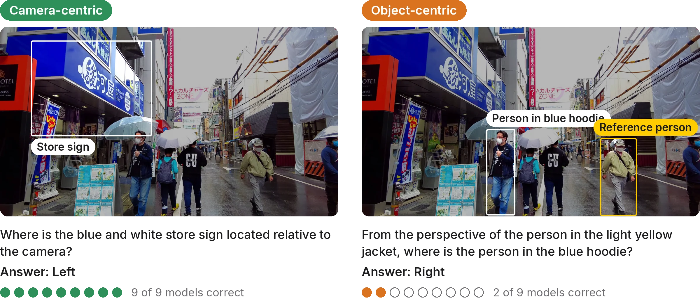
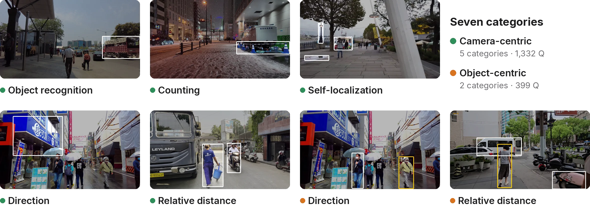
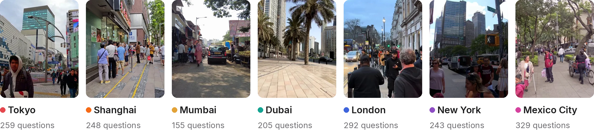
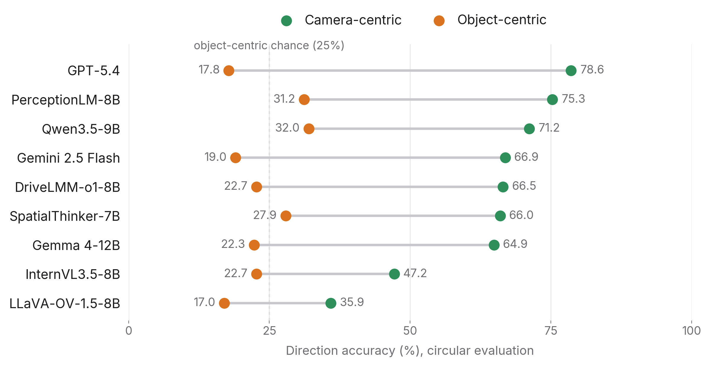

# UrbanStreetVQA: A Benchmark for Visual Understanding of Urban Street Views [ACCV 2026]

**Ziliang Huang**<sup>1</sup> &nbsp; [**Kosuke Kurihara**](https://kosuke-kurihara.github.io/)<sup>1</sup> &nbsp; [**Kiyoharu Aizawa**](https://sites.google.com/view/aizawa-kiyoharu)<sup>1,2</sup> &nbsp; [**Takayuki Hamamoto**](https://www.tus.ac.jp/ridai/doc/ji/RIJIA01Detail.php?act=&kin=ken&diu=1d93&pri=en)<sup>1</sup>

<sup>1</sup>*Tokyo University of Science* &nbsp; <sup>2</sup>*The University of Tokyo*

[**🌐 Project Page**](https://hamamototlab.github.io/UrbanStreetVQA/) &nbsp; **📄 Paper (coming soon)**

<picture>
  <source media="(prefers-color-scheme: dark)" srcset="assets/readme/teaser_dark.webp">
  
</picture>

UrbanStreetVQA is a visual question answering benchmark built from videos captured from a pedestrian viewpoint in real urban streets. It evaluates perception and spatial reasoning, and asks spatial questions from two perspectives: the camera's (*camera-centric*) and a person's in the scene (*object-centric*).

This repository contains the questions, the information needed to rebuild the images from their source videos, and the code for evaluation and fine-tuning. It does not include the images themselves.

## News

- **September 2026:** UrbanStreetVQA was accepted to ACCV 2026.
- **October 2026:** Released the benchmark annotations and the evaluation code.

## Benchmark Contents

<picture>
  <source media="(prefers-color-scheme: dark)" srcset="assets/readme/categories_dark.webp">
  
</picture>

The benchmark contains 1,731 human-verified questions over 854 images in seven categories. Three categories test perception (object recognition, counting, self-localization). Direction and relative-distance estimation are each asked from both perspectives. Object-centric answers are derived from geometry (detection, relative depth, and the reference person's body orientation) and then checked by human annotators.

<picture>
  <source media="(prefers-color-scheme: dark)" srcset="assets/readme/cities_dark.webp">
  
</picture>

The images come from 35 walking videos (about 31 hours) in seven cities, with at least 20 questions for every city and category. See `DATASET.md` for the data format.

## Repository Layout

- `data/benchmark/`: the benchmark questions.
- `data/train/`: the training questions used in the fine-tuning experiments.
- `data/sources/`: source video IDs and frame timestamps.
- `scripts/`: `download_frames.py`, which downloads the source videos and extracts the frames.
- `evaluation/`: evaluation scripts for GPT-5.4, Gemini 2.5 Flash, Qwen3.5, Gemma 4, InternVL3.5, and LLaVA-OneVision-1.5.
- `finetuning/`: component-wise fine-tuning of Qwen3.5.
- `docs/dependencies.md`: dependencies and details of the circular-evaluation protocol.
- `DATASET.md`: data format and field descriptions.

## Setup

1. Install Python 3 and [FFmpeg](https://ffmpeg.org/) (for example, `sudo apt install ffmpeg` or `brew install ffmpeg`).
2. Clone the repository and install the Python dependencies. This also installs [yt-dlp](https://github.com/yt-dlp/yt-dlp), which is used to download the videos.

```bash
git clone https://github.com/hamamototlab/UrbanStreetVQA.git
cd UrbanStreetVQA
pip install -r requirements.txt
```

## Getting the Data

We do not redistribute the images. The repository contains the questions and the information needed to rebuild every image from its source video; you download the videos and extract the frames yourself.

| File | Contents |
|:--|:--|
| `data/benchmark/urbanstreetvqa.jsonl` | The benchmark: 1,731 questions over 854 images |
| `data/train/urbanstreetvqa_train.jsonl` | Training set for the fine-tuning experiments: 3,622 questions over 1,780 images (no overlap with the benchmark) |
| `data/sources/videos.csv` | The 35 source videos: video key, city, YouTube ID and URL |
| `data/sources/frames.csv` | One row per image: file name, video key, timestamp (seconds), split, and city |

### 1. Download the videos and extract the frames

```bash
# Benchmark images (854), needed for evaluation
python scripts/download_frames.py --split benchmark --output-dir data/frames/benchmark

# Training images (1,780), needed only for fine-tuning
python scripts/download_frames.py --split train --output-dir data/frames/train
```

The script downloads each source video with yt-dlp, cuts the frames at the timestamps in `data/sources/frames.csv` with FFmpeg, and deletes the video once its frames are saved. Add `--keep-videos` to keep the downloaded videos. If the run stops partway, run the same command again with `--skip-existing` to continue without re-extracting the frames you already have. Run `python scripts/download_frames.py --help` for the other options, such as the video cache folder.

Each frame is saved as `data/frames/<split>/<city>/<video_key>/<image>`, the location the evaluation and fine-tuning scripts read from.

### 2. Check the result

```bash
find data/frames/benchmark -name "*.jpg" | wc -l   # should print 854
find data/frames/train -name "*.jpg" | wc -l       # should print 1780
```

After these steps, the `data/` folder looks like this:

```text
data/
├── benchmark/urbanstreetvqa.jsonl
├── train/urbanstreetvqa_train.jsonl
├── sources/
│   ├── videos.csv
│   └── frames.csv
└── frames/
    ├── benchmark/<city>/<video_key>/<image>.jpg
    └── train/<city>/<video_key>/<image>.jpg
```

### If a video is no longer available

A source video may be removed or made private on YouTube after release. In that case, the questions on its frames cannot be rebuilt. Please [open an issue](https://github.com/hamamototlab/UrbanStreetVQA/issues) and tell us which video ID failed. If downloads fail for every video, update yt-dlp first (`pip install -U yt-dlp`), since YouTube changes often break older versions.

### Terms of use

The videos belong to their original uploaders. Download and use them only for research, in line with YouTube's Terms of Service, and do not redistribute the videos or the extracted frames. The benchmark must not be used to identify or track individuals.

## Evaluation

The paper evaluates six models:

| Model | Script |
|---|---|
| Qwen3.5-VL | `evaluation/qwen35.py` |
| GPT-5.4 | `evaluation/gpt.py` |
| Gemini 2.5 Flash | `evaluation/gemini.py` |
| Gemma 4 | `evaluation/gemma.py` |
| InternVL3.5 | `evaluation/internvl.py` |
| LLaVA-OneVision-1.5 | `evaluation/llava.py` |

Evaluation scripts share a common CLI:

```bash
python evaluation/qwen35.py \
    --annotations data/benchmark/urbanstreetvqa.jsonl \
    --image-dir data/frames/benchmark \
    --model-path PATH/TO/Qwen3.5-VL \
    --output-dir results_qwen35 \
    --auto-yes
```

`qwen35.py`, `internvl.py`, and `llava.py` ask for confirmation before running; add `--auto-yes` to skip the prompt.

Local models (`qwen35.py`, `gemma.py`, `internvl.py`, `llava.py`) take `--model-path`. API
models read their key from an environment variable (`OPENAI_API_KEY` for GPT, `GEMINI_API_KEY`
for Gemini) — **never** hard-code keys.

```bash
export GEMINI_API_KEY=...
python evaluation/gemini.py \
    --annotations data/benchmark/urbanstreetvqa.jsonl \
    --image-dir data/frames/benchmark \
    --output-dir results_gemini
```

### Circular Evaluation

- **Multiple-choice:** each question is asked under all cyclic permutations of the option order;
  it counts as correct only if the model is correct on **every** rotation.
- **Counting:** exact numerical match, with **no** rotation.

This protocol is implemented consistently across the evaluation scripts.

## Fine-tuning

Component-wise fine-tuning of plain Qwen3.5-VL (no fusion) in three cumulative conditions:

- **(a) Projector only** — train the projector (merger); LLM and ViT frozen.
- **(b) Projector + LLM** — projector + LLM LoRA (r=16, α=32).
- **(c) Projector + LLM + ViT** — (b) plus unfreezing the ViT at 1/10 the learning rate.

```bash
python finetuning/train_qwen35.py --config finetuning/config.yaml --tune_mode projector_only
python finetuning/train_qwen35.py --config finetuning/config.yaml --tune_mode projector_lora
python finetuning/train_qwen35.py --config finetuning/config.yaml --tune_mode projector_lora_vit
```

Settings (`finetuning/config.yaml`): LoRA rank 16 / α 32 / dropout 0.05; AdamW
(β1=0.9, β2=0.95); 3 epochs; cosine schedule; 5% warmup; projector/LLM lr 1e-4; ViT lr 1e-5;
effective batch size 8 (batch 1 × grad-accum 8).

### Fine-tuning Results

Component-wise fine-tuning of Qwen3.5 reveals a different behavior between
camera-centric and object-centric direction reasoning.

| Trainable modules | Camera Dir. | Object Dir. | Overall |
|---|---:|---:|---:|
| Baseline | 71.2 | 32.0 | 69.5 |
| Projector only | 91.6 | 25.1 | 72.0 |
| Projector + LLM | **96.1** | 30.8 | 76.8 |
| Projector + LLM + ViT | 93.5 | **40.1** | **76.9** |

Camera-centric direction improves substantially by adapting the projector and LLM,
whereas object-centric direction improves only when the **ViT is also updated**.
This suggests that adapting the visual encoder is particularly important for
object-centric direction reasoning.

## Results

<picture>
  <source media="(prefers-color-scheme: dark)" srcset="assets/readme/direction_gap_dark.png">
  
</picture>

| Model | Obj. recog. | Count | Self-loc. | Dir. (cam) | Dist. (cam) | Dir. (obj) | Dist. (obj) | All |
|:--|--:|--:|--:|--:|--:|--:|--:|--:|
| GPT-5.4 | 82.2 | 61.3 | 61.4 | **78.6** | 84.7 | 17.8 | **78.9** | 67.9 |
| Gemini 2.5 Flash | 85.5 | 49.3 | 72.9 | 66.9 | 84.7 | 19.0 | 62.5 | 63.1 |
| InternVL3.5-8B | 83.6 | 64.0 | 72.1 | 47.2 | 83.6 | 22.7 | 66.4 | 60.2 |
| LLaVA-OV-1.5-8B | 84.9 | 38.2 | 59.3 | 35.9 | 75.1 | 17.0 | 55.9 | 49.5 |
| Gemma 4-12B | 83.6 | 56.0 | **75.7** | 64.9 | 85.0 | 22.3 | 75.0 | 65.2 |
| Qwen3.5-9B | 86.2 | **70.2** | 70.7 | 71.2 | 82.7 | **32.0** | 75.7 | **69.5** |
| PerceptionLM-8B | **88.2** | 52.0 | 68.6 | 75.3 | **87.8** | 31.2 | 61.2 | 67.9 |
| SpatialThinker-7B | 78.9 | 60.9 | 63.6 | 66.0 | 85.0 | 27.9 | 62.5 | 64.4 |
| DriveLMM-o1-8B | 72.4 | 49.3 | 51.4 | 66.5 | 83.0 | 22.7 | 70.4 | 61.0 |
| *Human (5 annotators)* | *94.3* | *93.3* | *93.3* | *98.1* | *91.4* | *88.6* | *96.2* | *93.6* |

Accuracy (%) under circular evaluation: a multiple-choice question counts as correct only if the model picks the right answer under every rotation of the options. Counting is scored by exact match. On the same direction task, every model does far better from the camera's perspective than from a person's, and six of nine models fall below the 25% chance rate from a person's perspective.

## Licenses

UrbanStreetVQA uses distinct licenses for code, annotations, and source media:

- **Repository code** (`evaluation/`, `finetuning/`, `scripts/`): **Apache-2.0** — see
  [`LICENSE`](LICENSE).
- **QA annotations** (`data/benchmark/`, `data/train/`, `data/sources/`): **CC BY 4.0**
  (<https://creativecommons.org/licenses/by/4.0/>) — see [`data/LICENSE.md`](data/LICENSE.md).
  Attribution is required. This applies only to the author-created annotations.
- **Source media** (the YouTube videos and extracted frames): **not redistributed**. The
  original rights remain with the original uploaders / rights holders; this project claims no
  ownership of them (see [Getting the Data](#getting-the-data) and [`DATASET.md`](DATASET.md)).

## Citation

```bibtex
@inproceedings{huang2026urbanstreetvqa,
  title     = {UrbanStreetVQA: A Benchmark for Visual Understanding of Urban Street Views},
  author    = {Huang, Ziliang and Kurihara, Kosuke and Aizawa, Kiyoharu and Hamamoto, Takayuki},
  booktitle = {Proceedings of the Asian Conference on Computer Vision (ACCV)},
  year      = {2026}
}
```
